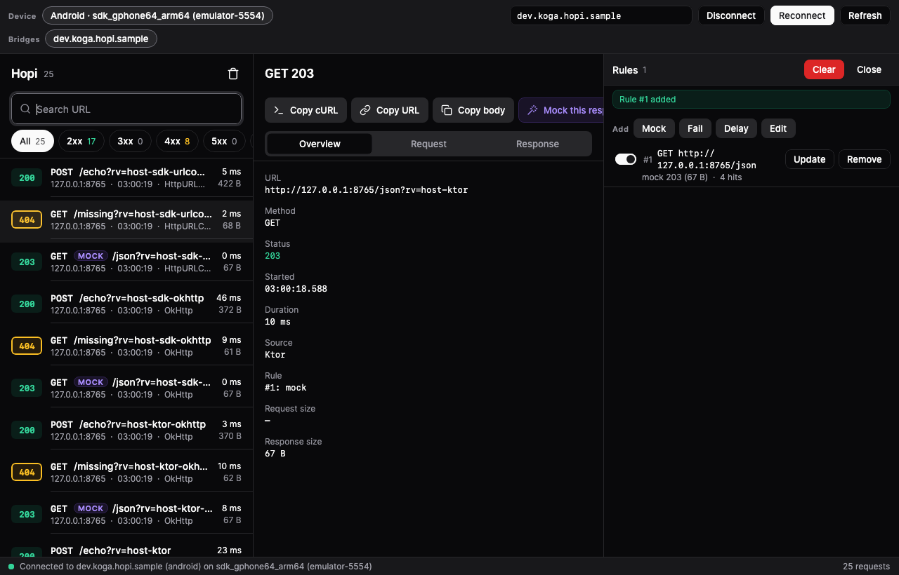
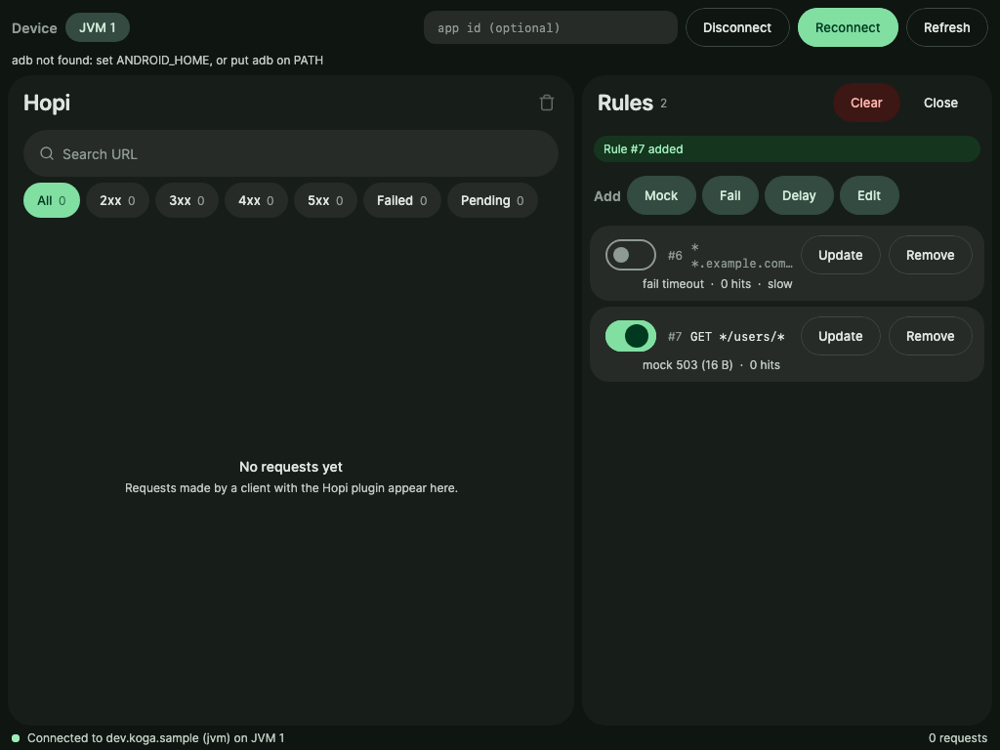
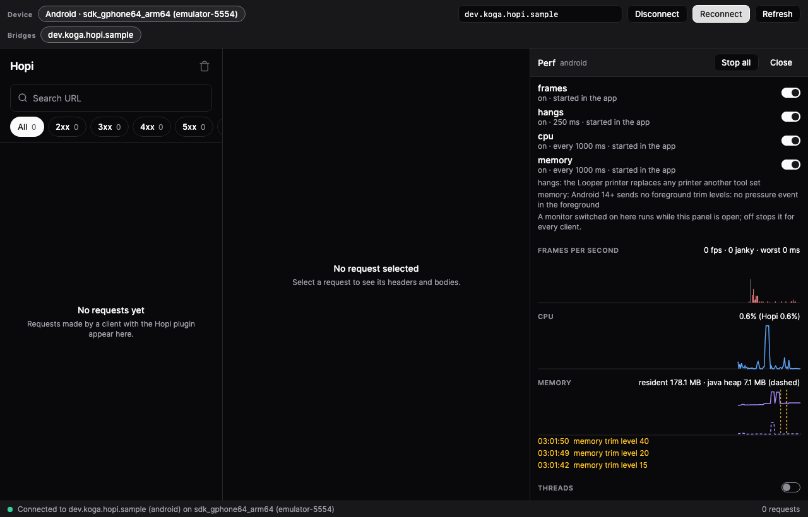

# Hopi

Debug-only network inspector and performance monitor for Android, iOS (KMP) and JVM apps, with a
native macOS viewer and a CLI built for AI agents.

[](https://github.com/FelipeKoga/hopi/actions/workflows/ci.yml?query=branch%3Amain)
[](LICENSE)
[](https://central.sonatype.com/artifact/io.github.felipekoga.hopi/hopi-core)

> [!WARNING]
> Experimental and developed entirely with AI (Claude Code). APIs may change. Debug builds only.



## What it does

- **Captures every request**: OkHttp and `HttpURLConnection` on Android, URLSession on iOS (SDKs
  included), Ktor on the JVM. No per-client code.
- **Rules**: mock, fail, delay or edit requests and responses, in memory, for the session.
- **Performance**: frames, hangs (with main-thread stacks), CPU and memory, off until started.
- **Safe by default**: credentials redacted everywhere, nothing leaves the device, no runtime in
  release builds, zero cost while idle.

## Setup

Group `io.github.felipekoga.hopi`, version `0.1.0`, from `mavenCentral()` (plugin included; add it
to `pluginManagement` too). Before the first release: `./gradlew publishToMavenLocal` here and
`mavenLocal()` in your repositories.

**Android** (application module):

```kotlin
plugins { id("io.github.felipekoga.hopi") version "0.1.0" }

dependencies {
    debugImplementation("io.github.felipekoga.hopi:hopi-network:0.1.0")
    debugImplementation("io.github.felipekoga.hopi:hopi-perf:0.1.0")   // optional
}
```

**iOS (KMP)**: the same block in the shared module, then `Hopi.shared.start()` first thing at
launch in Swift. Release builds link nothing.

**JVM (Ktor)**: `hopi-ktor` + `hopi-start`, call `HopiStart.start()` before building clients, and
`install(Hopi)` in each `HttpClient`.

Details, options and requirements (Kotlin 2.2+, AGP 8+, Gradle 8+): [Guide](docs/GUIDE.md).

## macOS viewer

Finds debug apps on Android phones and emulators (USB or Wi-Fi), iPhones on USB, iOS simulators
and JVM processes. Requests and detail side by side, rules ("Mock This Response" from any request),
live performance charts, cURL, HAR/NDJSON export, whole bodies while attached.

| Rules | Performance |
| --- | --- |
|  |  |

Download the `.dmg` from [Releases](https://github.com/FelipeKoga/hopi/releases) (macOS 26; unsigned
for now: right-click, Open) or build it: `scripts/mac-dmg.sh` (Xcode 26+).

## CLI

Every command has `--json` (one object per line, a stable contract) and clear exit codes. Build
with `./gradlew :hopi-cli:installDist` (`hopi-cli/build/install/hopi-cli/bin/hopi`).

```bash
hopi apps                                         # apps with Hopi; with one, --app is optional
hopi list --status 4xx,5xx,failed --url /users    # filter what was captured
hopi wait --url /login --json                     # block until a new matching request ends
hopi get 42 --body response | jq .                # one body, raw
hopi tail --full-bodies --json                    # live, whole bodies
hopi mock add --from 42 --status 500              # mock that request's response
hopi export > session.har                         # HAR or NDJSON
hopi perf start --frames --hangs && hopi hangs    # monitors
```

All commands: [Log stream and CLI](docs/GUIDE.md#log-stream-and-cli-for-ai-agents).

## Docs

[Guide](docs/GUIDE.md) · [Architecture](docs/ARCHITECTURE.md) · [Roadmap](docs/ROADMAP.md) ·
[Releasing](docs/RELEASING.md) · building and the base check: [Building](docs/GUIDE.md#building)

Inspired by [Pulse](https://github.com/kean/Pulse), [Chucker](https://github.com/ChuckerTeam/chucker),
[Flipper](https://github.com/meta/flipper), [DebugSwift](https://github.com/DebugSwift/DebugSwift),
[Pluto](https://github.com/androidPluto/pluto), [netfox](https://github.com/kasketis/netfox) and
[Wormholy](https://github.com/pmusolino/Wormholy).

Apache-2.0 ([LICENSE](LICENSE)); `hopi-ui`'s Open Runde fonts are under the SIL OFL 1.1.
